<!-- HEADER ANIMASI -->
<p align="center">
  
</p>

<!-- TEKS MENGETIK -->
<p align="center">
  
</p>

<p align="center">
  <a href="https://mazterzee12.github.io">
    
  </a>
  <a href="https://github.com/MazterZee12?tab=repositories">
    
  </a>
</p>

<!-- ANJING BERLARI (butuh file dog.svg di root repo) -->
<p align="center">
  
</p>

---

## 👨‍💻 Tentang Saya

Mahasiswa **D3 Teknologi Informasi di Institut Teknologi Del**. Saya suka membangun aplikasi web, mulai dari rancangan database sampai tampilan yang rapi, dan terus belajar dari setiap project.

```js
const rio = {
  nama: "Rio Damanik",
  kampus: "Institut Teknologi Del",
  fokus: ["Web Development", "Backend dengan Laravel"],
  sedangDipelajari: ["Mobile Application", "Data Analysis dengan Python"],
  status: "Terbuka untuk kolaborasi",
};
```

## 🛠️ Tech Stack

<p align="center">
  
  
  
  
  
  
  
  
  
  
</p>

## 🚀 Project Pilihan

<table width="100%">
  <tr>
    <td width="50%" valign="top">
      <h3>🌐 Portfolio Website</h3>
      Website portfolio pribadi saya.<br/><br/>
      <br/><br/>
      <a href="https://github.com/MazterZee12/MazterZee12.github.io">Lihat repo</a> ·
      <a href="https://mazterzee12.github.io">Live</a>
    </td>
    <td width="50%" valign="top">
      <h3>🏖️ Wisata Pasir Putih Parparean</h3>
      Sistem informasi wisata Proyek Akhir Kelompok 11.<br/><br/>
      
      <br/><br/>
      <a href="https://github.com/MazterZee12/ProyekAkhir_Kelompok11">Lihat repo</a>
    </td>
  </tr>
</table>

## 📊 GitHub Stats

<p align="center">
  
  
</p>

<p align="center">
  
</p>

## 📈 Grafik Aktivitas

<!-- BEGIN ACTIVITY-GRAPH -->
<picture>
  <source media="(max-width: 767px)" srcset="activity-graph-mobile.svg">
  
</picture>
<!-- END ACTIVITY-GRAPH -->

## 📫 Hubungi Saya

<p align="center">
  <a href="https://github.com/MazterZee12"></a>
  <a href="mailto:mazterzee@gmail.com"></a>
</p>

<p align="center">
  
</p>
